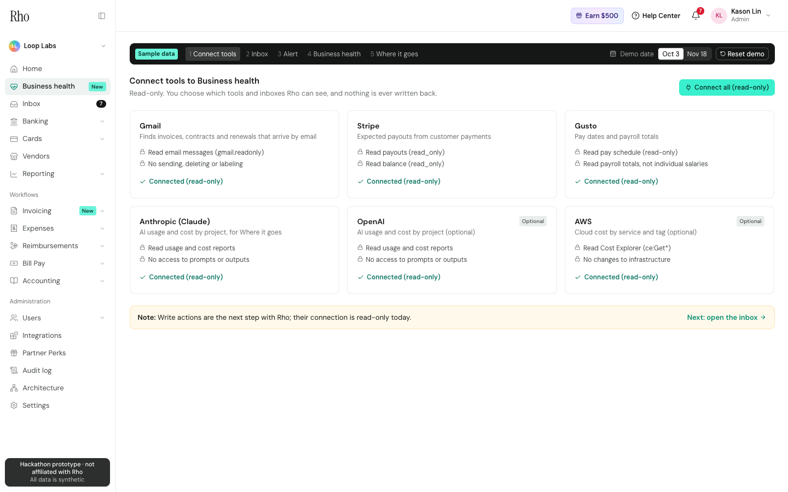
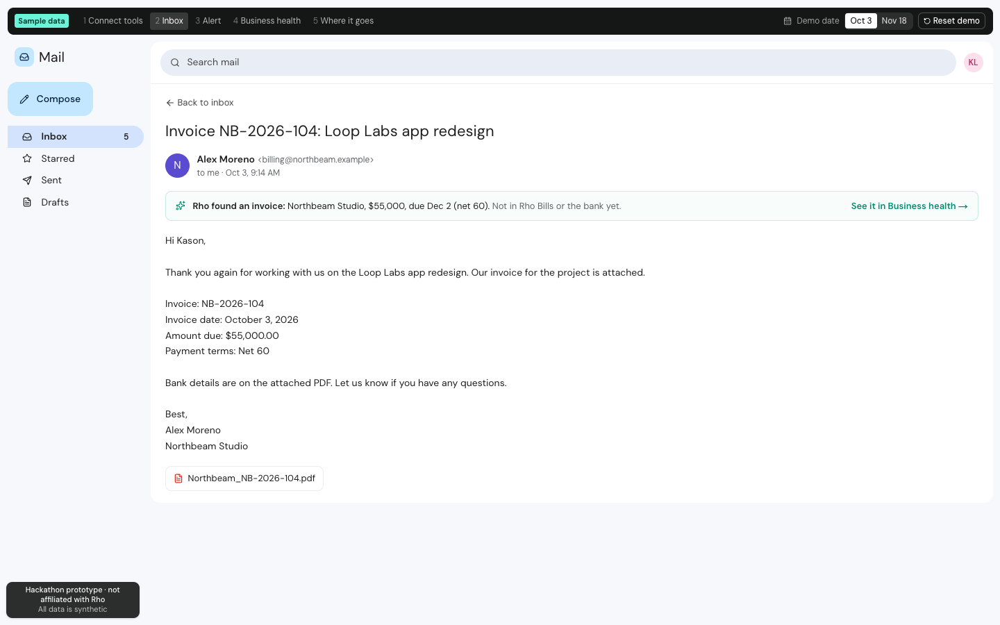
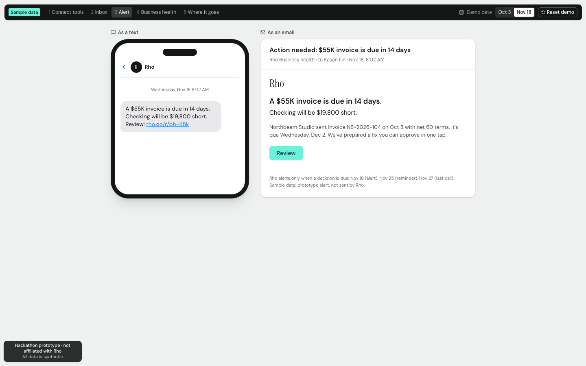
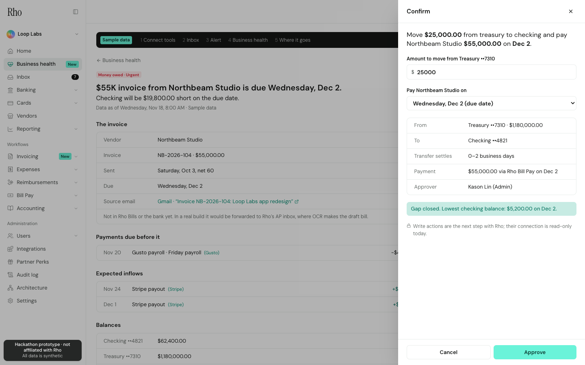
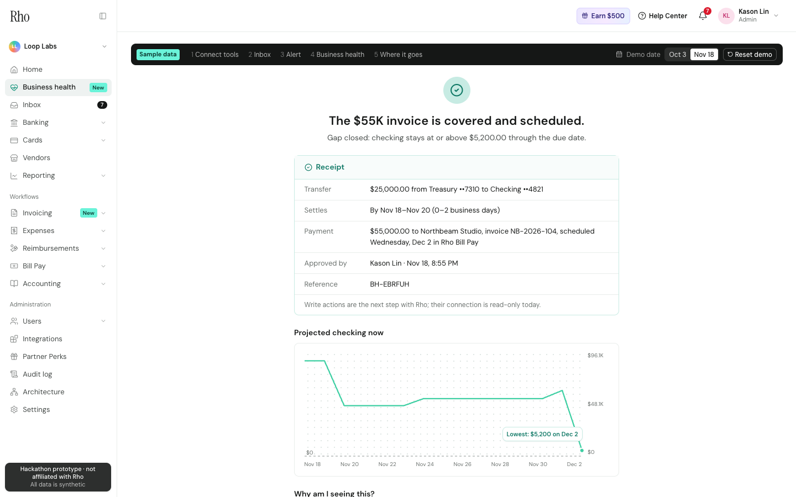
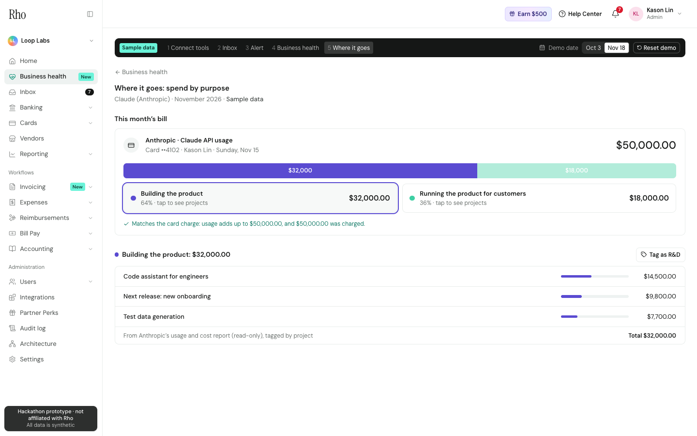

# Rho Business health (case-competition prototype)

**See what you owe before it's due. Approve the fix in one tap.**

A clickable prototype of a new **Business health** tab inside a replica of Rho's web app. Rho finds money owed that isn't in the bank yet (like an invoice sitting in email), projects checking against everything due, and prepares the fix. The founder says yes or no, and no money moves without a tap.

> Prototype only, not affiliated with or endorsed by Rho. Every number is hand-seeded **sample data** (a made-up company, Loop Labs), nothing real is connected, and no money moves.

| Connect tools | The invoice email (Oct 3) | The alert (Nov 18) |
| --- | --- | --- |
|  |  |  |
| **Approval sheet** | **Done + receipt** | **Spend by purpose** |
|  |  |  |

The 90-second demo script is in [docs/demo-script.md](docs/demo-script.md).

## The story

1. **Oct 3.** A design agency, Northbeam Studio, emails a **$55,000 invoice** for the app redesign, on net-60 terms. Nobody enters it anywhere.
2. **Nov 18.** The demo date jumps forward, and Rho sends one alert by text and email: *"A $55K invoice is due in 14 days. Checking will be $19,800 short."* It has a **Review** button.
3. **Business health tab.** The tab shows:
   - **Coming up:** projected checking, with the Friday payroll (−$41,200), two Stripe payouts (+$14,000) and the invoice. Checking ends at **$19,800 short** on Dec 2, and every item links to its source.
   - **Needs you:** 3 cards.
   - **Where it goes:** spend by purpose.
4. **Approve.** The sheet says *"Move $25,000 from treasury to checking and pay Northbeam Studio $55,000 on Dec 2."*
   - The amount and date are editable, and a live preview shows whether the gap closes.
   - After **Approve**, the gap disappears, the invoice shows as scheduled, and a receipt appears.
   - Note: *Write actions are the next step with Rho; their connection is read-only today.*
5. **Where it goes.** The **$50,000 Claude bill** splits into **$32,000 "Building the product"** and **$18,000 "Running the product for customers"**. Tap a slice to see the projects behind it. The totals are checked against the card charge.

Click **Reset demo** in the dark presenter bar at any time to start over.

## Edit the numbers

All sample data is in plain JSON files in `src/data/business-health/`. Each file starts with an `_about` line saying what it's for.

| File | What's in it |
| --- | --- |
| `company.json` | Balances (checking $62,400, treasury $1,180,000), payroll, bills, burn, the unused tool |
| `inbox.json` | The mock inbox. The Northbeam email holds the invoice amount, date and terms in plain text |
| `stripe-payouts.json` | Expected Stripe payouts before the due date |
| `ai-usage.json` | Claude usage records tagged by project and purpose. They must add up to the card charge |
| `connections.json` | The tools you can connect, with their read-only permissions |

After changing a number:
- **Locally:** run `npm test` to check the story still adds up. The tests pin the spec numbers, so update them if you change the story on purpose.
- **On the live site:** push to GitHub and Vercel redeploys on its own.

## How it works

**Backend** (`src/app/api/health/`), real API routes:

| Route | What it does |
| --- | --- |
| `GET /api/health/inbox` | Reads the mock inbox and pulls out invoices (vendor, amount, sent date, terms, due date) |
| `GET /api/health/obligations` | The list of what's owed: invoices found in email, payroll, scheduled bills |
| `GET /api/health/forecast` | Projected checking day by day, the shortfall, the alert and the "Needs you" cards. Add `?transfer=20000&pay_date=2026-12-02` to preview a plan |
| `GET /api/health/spend` | The AI bill split into building vs. running, with the projects behind each |
| `POST /api/health/approve` | Approves the plan (admins only, pay on or before the due date) and returns the receipt |
| `POST /api/health/state` | Jumps the demo date or connects a tool |
| `POST /api/health/feedback` | "Not now" or "This is wrong" on a card |
| `POST /api/health/reset` | Back to Oct 3 |

**The logic** (`src/lib/health/`) is small, commented files:
- `extract.ts`: invoices from email
- `forecast.ts`: the cash projection, the alert and the $25K suggestion (shortfall plus a buffer, rounded up to $5,000)
- `cards.ts`: "Needs you", 3 cards at most, urgent first
- `spend.ts`: the building/running split

**Demo state.** Each viewer's demo state (date, connected tools, approval) is kept in a browser cookie. Viewers never affect each other, nothing needs a database, and Reset just clears the cookie.

**The rest of the app** is the Rho replica from earlier rounds:
- **Home dashboard:** Rho's layout, now with Business health on top.
- **Rho Inbox:** one feed for all Rho products, stored in Supabase with live updates.
- **Audit log and Architecture page:** the Architecture page includes "How Business health plugs into Rho", which marks what's evidence and what's an assumption.
- **The earlier Check-in prototype:** replaced by Business health. Its code is still in `src/lib/checkin/`, and its old links redirect.

## Run it

**You'll need:** Node 20+.

1. `npm install`
2. `npm run dev`, then open http://localhost:3000. Start the demo at `/business-health/connect`, or `/mailbox`.

**Business health needs no setup:** no database and no keys.

**The Rho Inbox and the Home dashboard** read from a Supabase database. Copy `.env.example` to `.env.local` and fill in the Supabase values, run the SQL files in `supabase/migrations/` once, then `npm run seed`. The live Vercel site already has these settings.

| Script | What it does |
| --- | --- |
| `npm test` | Checks the story's numbers and the Inbox logic |
| `npm run smoke` | Clicks the whole story through the API against a running server (seed before and after) |
| `npm run screenshots` | Re-captures `docs/screenshots/` with headless Chrome |
| `npm run build:check` | Production build that doesn't disturb a running dev server |

## Deploying

The repo is connected to Vercel, so every push to `main` deploys automatically. **No extra environment steps** are needed for Business health. The Supabase settings for the Inbox and Home are already in Vercel.

## Design notes

- **Layout:** the frame copies the layout and color tokens of Rho's signed-in dashboard (`docs/design-notes.md`).
- **Fonts:** Rho's licensed fonts are replaced with free look-alikes; the main stand-in is DM Sans.
- **Logo:** the wordmark is typed text, not Rho's logo.
- **Copy and data:** all text and data are our own.
