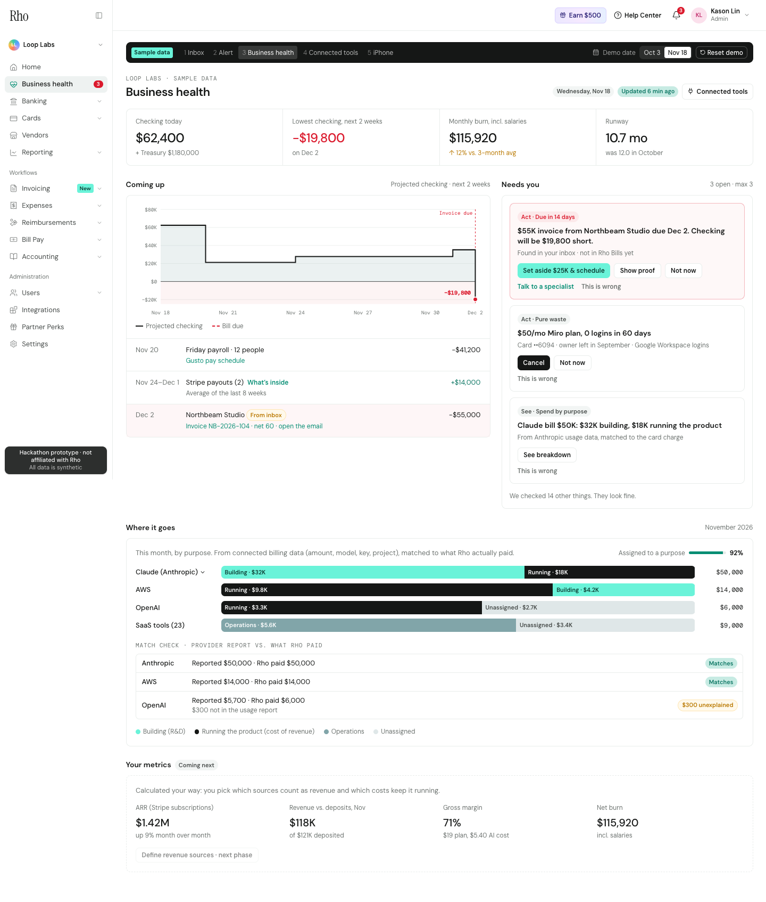
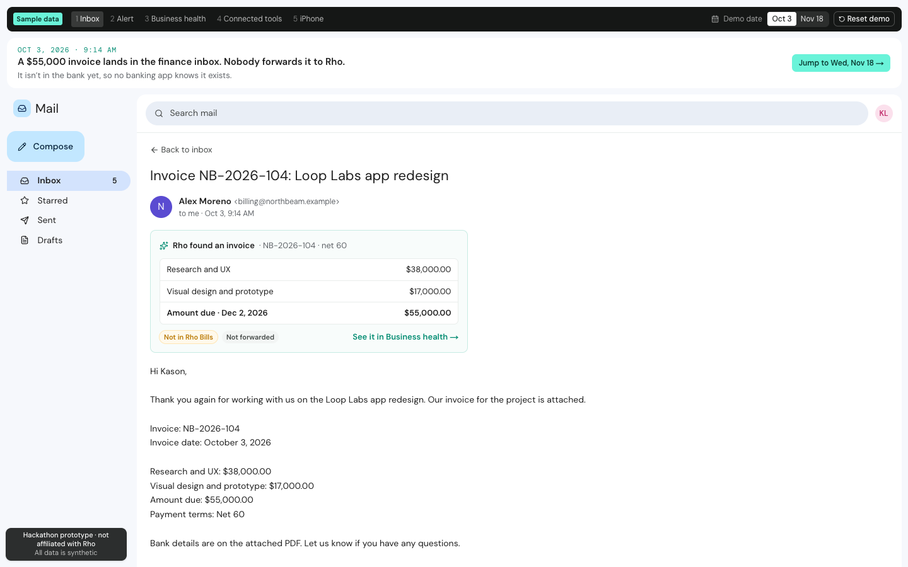
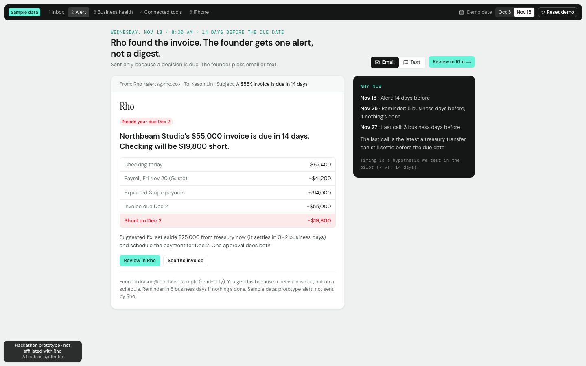
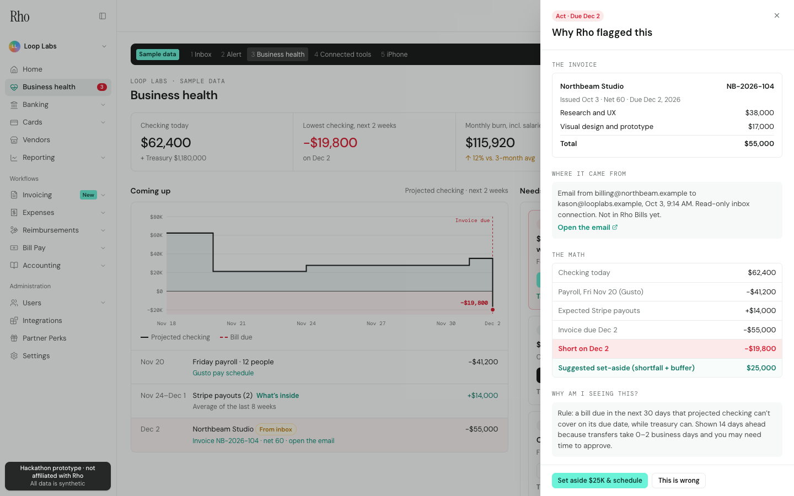
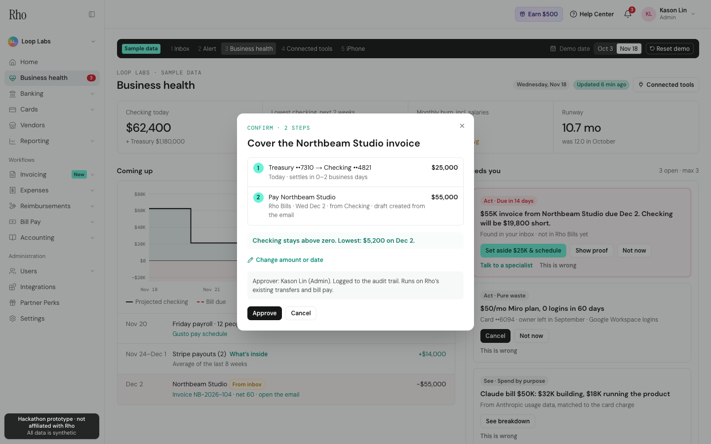
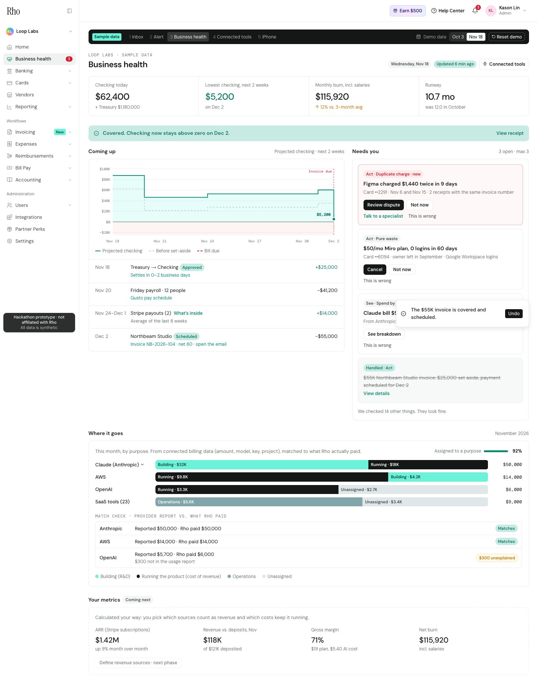
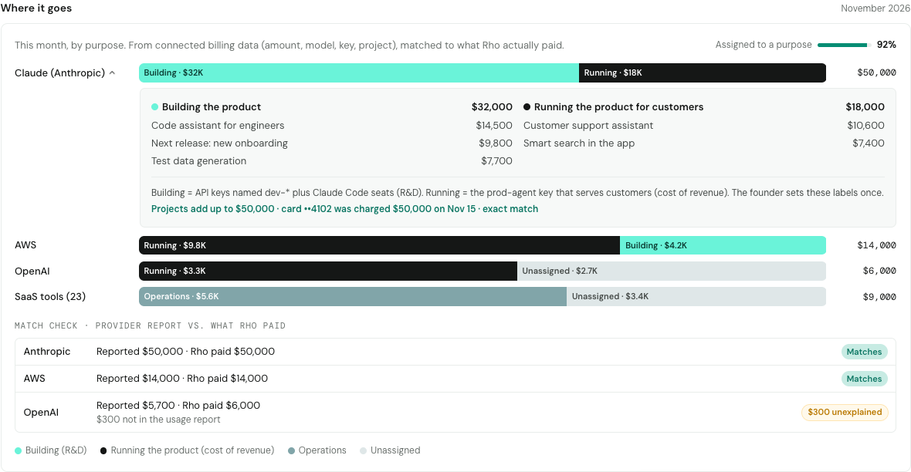
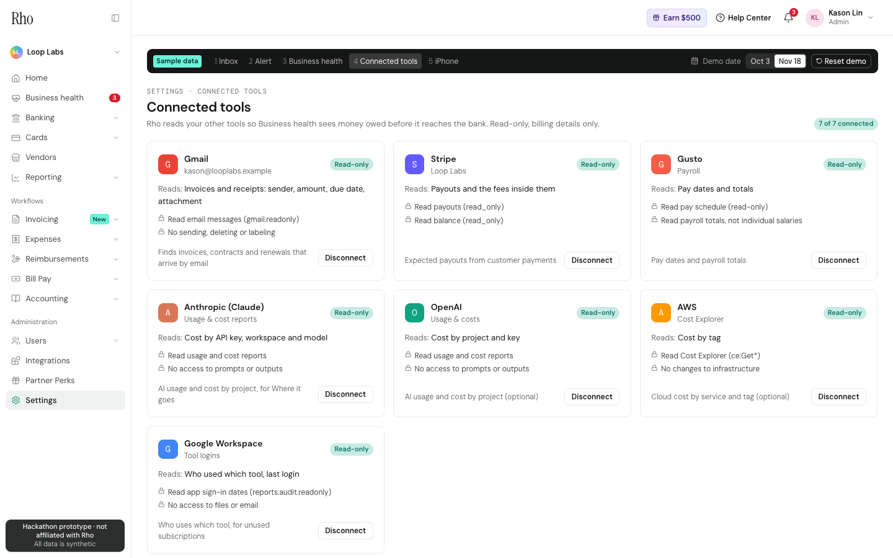
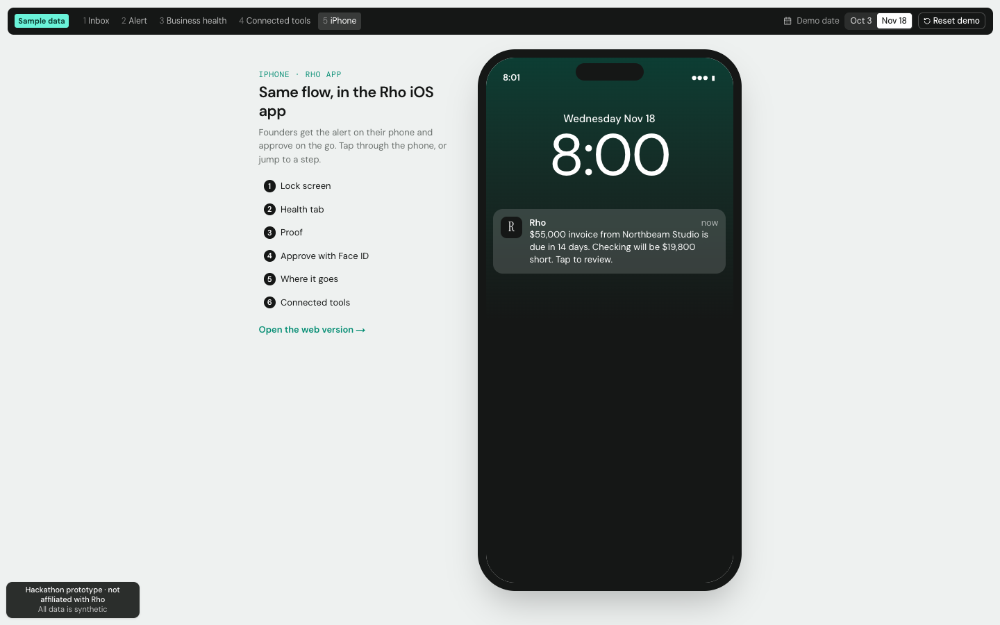
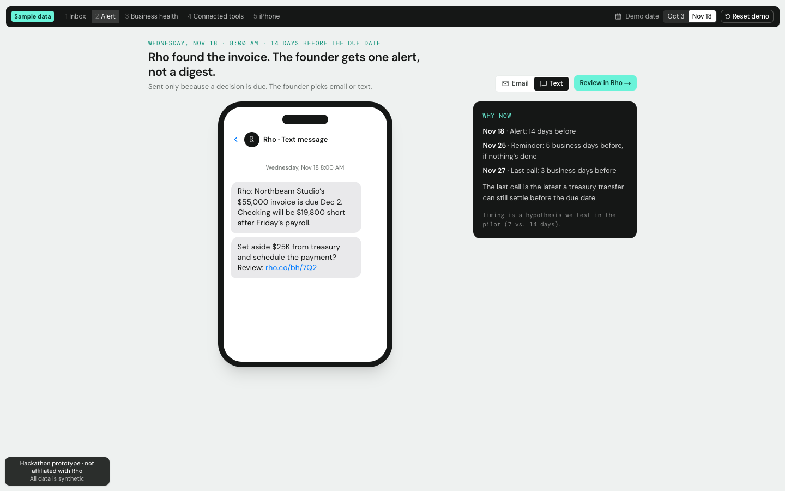

# Rho Business health (case-competition prototype)

**See what you owe before it's due. Approve the fix in one tap.**

A clickable prototype of a new **Business health** tab inside a replica of Rho's web app. Rho finds money owed that isn't in the bank yet (like an invoice sitting in email), projects checking against everything due, and prepares the fix. The founder says yes or no, and no money moves without a tap. It works on the web and in an iPhone mode.

> Prototype only, not affiliated with or endorsed by Rho. Every number is hand-seeded **sample data** (a made-up company, Loop Labs), nothing real is connected, and no money moves.

| The invoice email (Oct 3) | The alert (Nov 18) | Proof drawer |
| --- | --- | --- |
|  |  |  |
| **Confirm (2 steps)** | **Covered** | **Where it goes** |
|  |  |  |
| **Connected tools** | **iPhone mode** | **Alert by text** |
|  |  |  |

- **Demo script (90 seconds):** [docs/demo-script.md](docs/demo-script.md)
- **How it plugs into Rho:** [docs/architecture.md](docs/architecture.md)

## The story

1. **Oct 3. The inbox.** Northbeam Studio, a design agency, emails a **$55,000 invoice** (Research and UX $38,000, Visual design $17,000) on net-60 terms. Nobody enters it anywhere.
2. **Nov 18. The alert.** Rho sends one alert, by email or text: *"A $55K invoice is due in 14 days. Checking will be $19,800 short."* It shows the math and a "Why now" schedule.
3. **The Business health tab.** It has five parts:
   - **KPI tiles:** checking, lowest checking in the next 2 weeks (−$19,800), burn, runway.
   - **Coming up:** a projected-checking chart, then each item with a link to its source: payroll, Stripe payouts (with "What's inside"), and the invoice.
   - **Needs you:** 3 cards at most, urgent first. Each card has "Not now", "This is wrong" (asks why) and "Talk to a specialist".
   - **Where it goes:** AI, cloud and tool spend by purpose for Claude, AWS, OpenAI and SaaS tools, with a match check against what Rho paid.
   - **Your metrics:** a preview of the next phase.
4. **Approve.** **Show proof** opens a side drawer with the invoice, the email, the math and the rule. **Set aside $25K & schedule** opens a 2-step confirm:
   - Step 1 moves $25,000 from treasury. Step 2 pays Northbeam $55,000 on Dec 2.
   - The amount and date are editable, and a live preview says whether the gap closes.
   - After **Approve**, the chart redraws above zero (the old line stays, dashed), a toast offers **Undo**, a receipt appears, and the invoice card is crossed out as handled.
   - Note: *Write actions are the next step with Rho; their connection is read-only today.*
5. **Next cards.** **Figma charged $1,440 twice** shows up, with a pre-filled dispute. A $50/mo Miro plan nobody uses can be cancelled and its card locked.
6. **Where it goes.** The **$50,000 Claude bill** splits into **$32,000 "Building the product"** and **$18,000 "Running the product for customers"**. Open it to see the projects behind each; the totals match the card charge exactly. OpenAI shows **$300 unexplained**.

Settings → **Connected tools** lists the 7 read-only connections, what Rho reads, and what it never reads. **iPhone mode** (`/iphone`) runs the same flow: lock-screen notification, Health tab, proof and confirm sheets, Face ID approval.

Click **Reset demo** in the dark presenter bar at any time to start over.

## Edit the numbers

All sample data is in plain JSON files in `src/data/business-health/`. Each file starts with an `_about` line saying what it's for.

| File | What's in it |
| --- | --- |
| `company.json` | Balances (checking $62,400, treasury $1,180,000), payroll, burn, the unused tool, the Figma duplicate, metrics preview |
| `inbox.json` | The mock inbox. The Northbeam email holds the invoice amount, line items, date and terms in plain text |
| `stripe-payouts.json` | Expected Stripe payouts before the due date, and what's inside each |
| `ai-usage.json` | Claude usage records tagged by project and purpose. They must add up to the card charge |
| `other-spend.json` | AWS, OpenAI and SaaS tools split by purpose, with each provider's own report vs. what was paid |
| `connections.json` | The 7 tools, their read-only permissions, what Rho reads and never reads |
| `users.json` | Who can approve (admins) and who can't |
| `home.json` | The Home dashboard's balance chart and monthly totals |

After changing a number:
- **Locally:** run `npm test` to check the story still adds up. The tests pin the spec numbers, so update them if you change the story on purpose.
- **On the live site:** push to GitHub and Vercel redeploys on its own.

## How it works

**Backend** (`src/app/api/health/`), real API routes:

| Route | What it does |
| --- | --- |
| `GET /api/health/inbox` | Reads the mock inbox and pulls out invoices (vendor, amount, line items, terms, due date) |
| `GET /api/health/obligations` | What's owed: invoices found in email, payroll, scheduled bills |
| `GET /api/health/forecast` | Everything the tab shows: projected checking, the shortfall, the alert, KPIs and cards. Add `?transfer=20000&pay_date=2026-12-02` to preview a plan |
| `GET /api/health/spend` | Spend by purpose for every provider, coverage and the match check |
| `POST /api/health/approve` | Approves the plan (admins only, pay on or before the due date) and returns the receipt |
| `POST /api/health/undo` | Takes the approval back |
| `POST /api/health/act` | Cancels the unused tool or submits the dispute (admins only) |
| `POST /api/health/feedback` | "Not now" or "This is wrong" (with a reason) on a card |
| `POST /api/health/state` | Jumps the demo date, or connects or disconnects a tool |
| `POST /api/health/reset` | Back to Oct 3 |

**The logic** (`src/lib/health/`) is small, commented files. See [docs/architecture.md](docs/architecture.md).

**Demo state.** Each viewer's demo state is kept in a browser cookie. Viewers never affect each other, nothing needs a database, and Reset just clears the cookie.

## Run it

**You'll need:** Node 20+. No database and no keys.

1. `npm install`
2. `npm run dev`, then open http://localhost:3000/mailbox.

| Script | What it does |
| --- | --- |
| `npm test` | Checks the story's numbers |
| `npm run smoke` | Clicks the whole story through the API against a running server |
| `npm run screenshots` | Re-captures `docs/screenshots/` with headless Chrome |
| `npm run build:check` | Production build that doesn't disturb a running dev server |

## Deploying

The repo is connected to Vercel, so every push to `main` deploys automatically. No environment variables are needed.

## Design notes

- **Layout:** the frame copies the layout and color tokens of Rho's signed-in dashboard (`docs/design-notes.md`).
- **Fonts:** Rho's licensed fonts are replaced with free look-alikes; the main stand-in is DM Sans.
- **Logo:** the wordmark is typed text, not Rho's logo.
- **Copy and data:** all text and data are our own.
