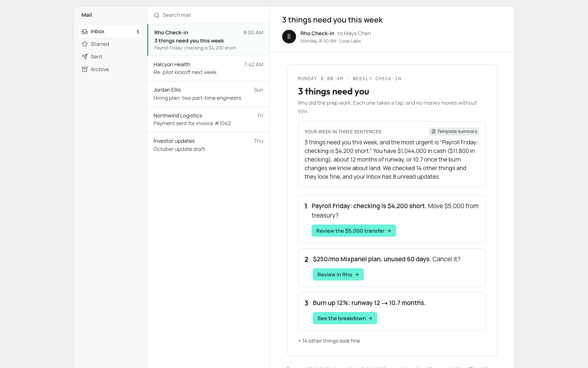
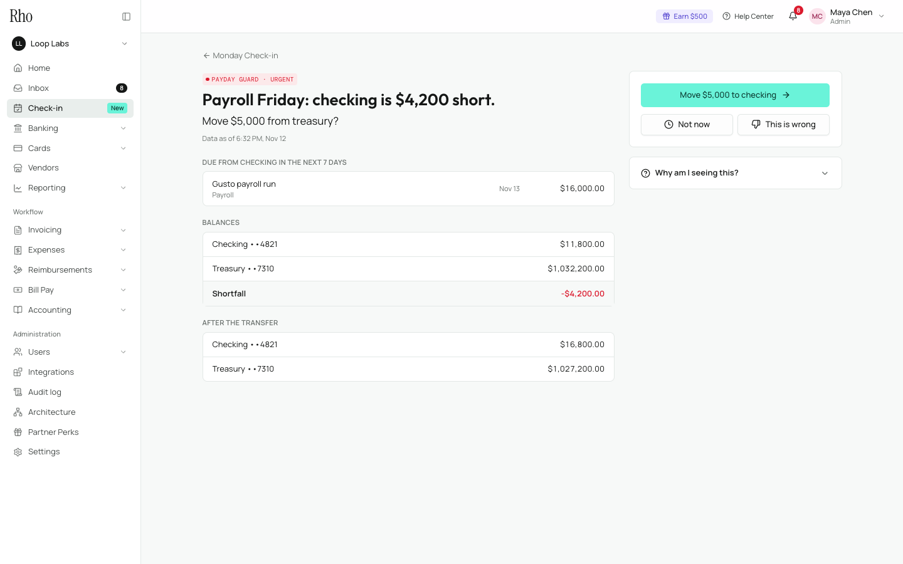
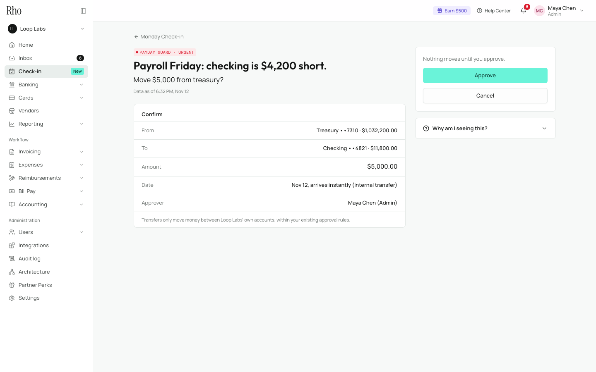
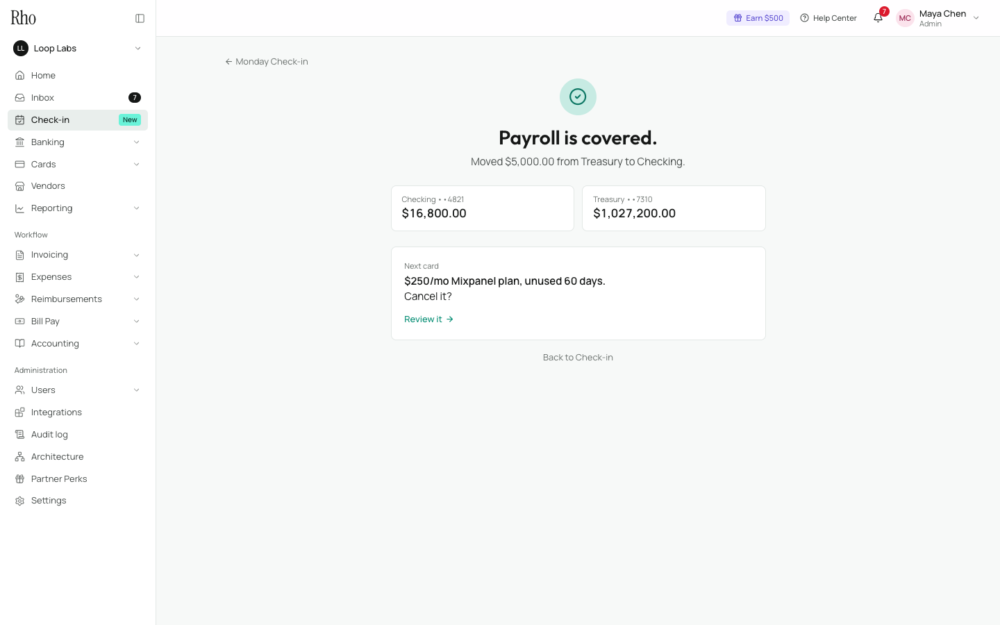
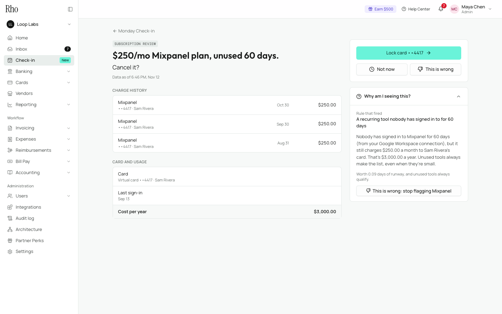
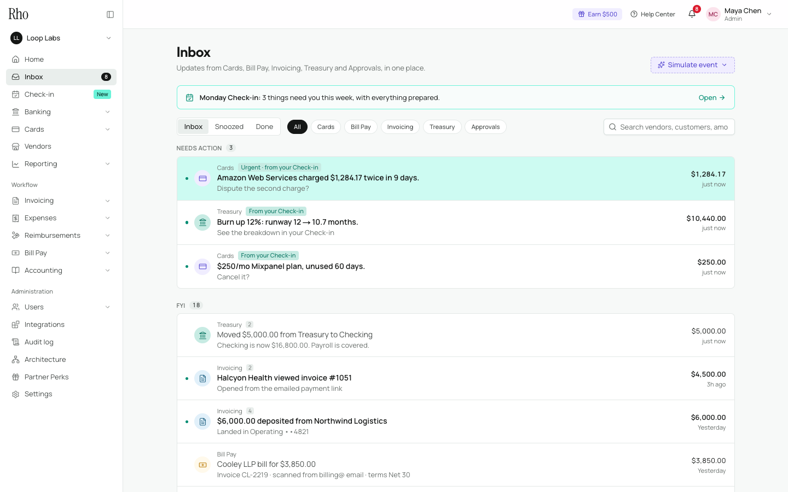
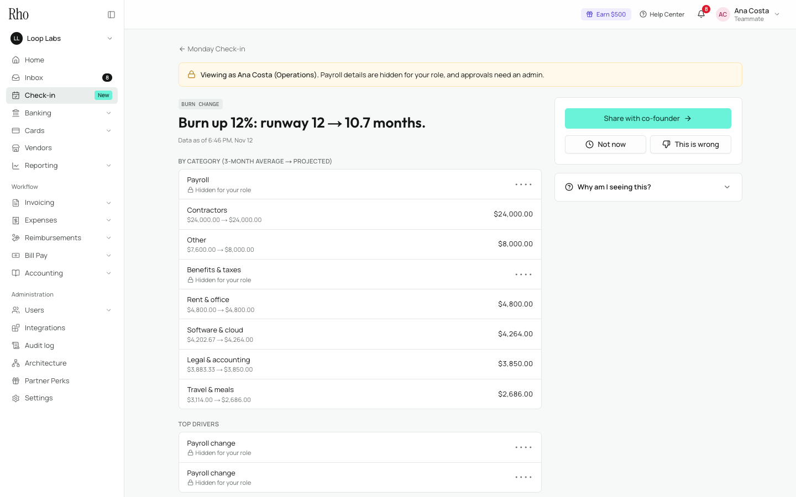
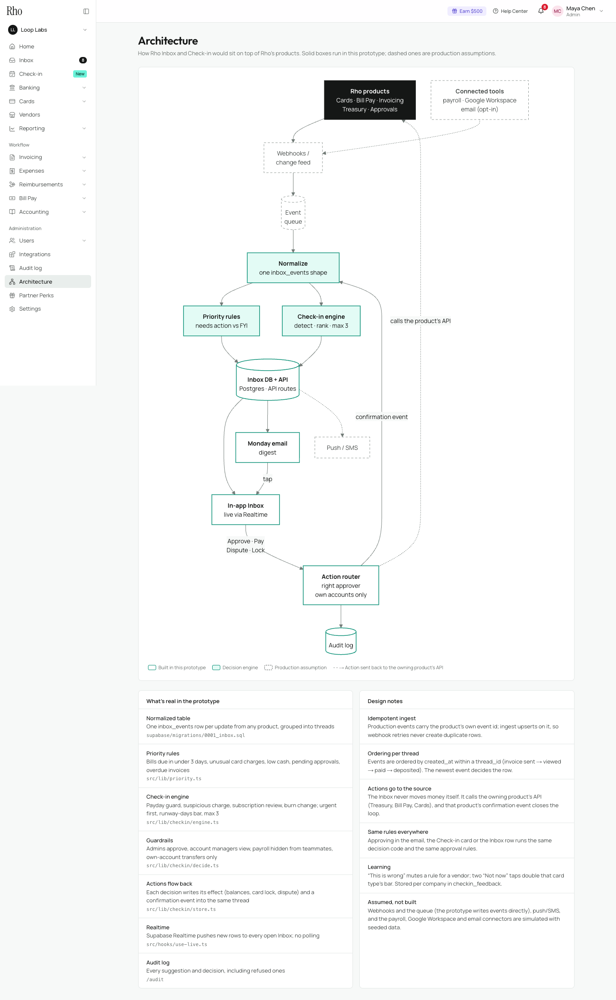
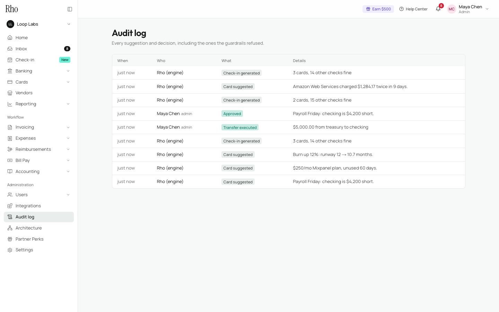
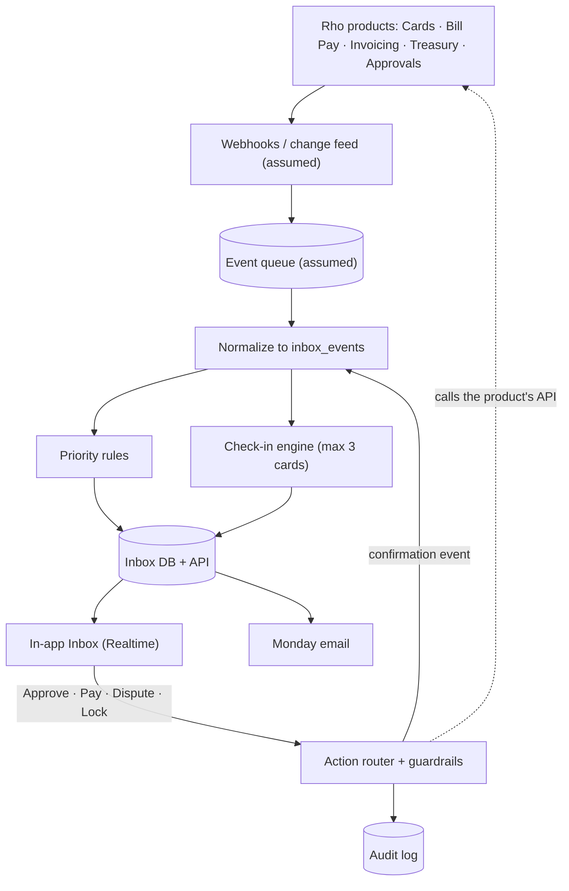

# Rho Inbox + Check-in

**A hackathon prototype for Rho.** One inbox for every Rho product, plus a Monday briefing with every decision prepared and ready to approve.

A founder or finance lead at a small company checks Cards, Bill Pay, Invoicing, Treasury and Approvals separately today. Rho already has all of that data. This prototype does two things with it:

- **Rho Inbox:** every update from every product in one Gmail-style feed, split into *Needs action* and *FYI*, with actions (Approve, Pay, Dispute) right on the row.
- **Rho Check-in:** once a week, Rho does the prep work and sends **at most three decision cards**, each with its proof, a prepared action and a one-tap approval. Everything else becomes one line: *“We checked 14 other things. They look fine.”*

> Prototype only. Not affiliated with or endorsed by Rho. All data is synthetic (a made-up company, Loop Labs), no real money moves, and anything about Rho's internal systems is an assumption.

| The Monday email | Proof behind a card | Confirm |
| --- | --- | --- |
|  |  |  |
| **Done** | **Why am I seeing this?** | **Inbox, with a live event** |
|  |  |  |
| **Teammate view (payroll hidden)** | **Architecture** | **Audit log** |
|  |  |  |

The 90-second demo is in [docs/demo-script.md](docs/demo-script.md).

---

## The demo company

**Loop Labs**, seed stage, 6 people. The numbers are chosen so the Monday Check-in produces exactly the briefing from the original spec:

| | |
| --- | --- |
| Cash | Checking $11,800 · Treasury $1,032,200 · Total $1,044,000 |
| Payroll Friday | $16,000, so checking is **$4,200 short**, and the card suggests moving **$5,000** |
| Unused tool | Mixpanel, **$250/mo**, nobody has signed in for **60 days** |
| Burn | $87,000 → **$97,440/mo (+12%)** from 2 new hires and a 10% raise found in a signed contract |
| Runway | **12.0 → 10.7 months** |

## How Check-in decides what to show

Four card types:

| Card | Fires when | Proof | Prepared action | Priority |
| --- | --- | --- | --- | --- |
| Payday guard | Bills + payroll due from checking in 7 days exceed the balance, and Treasury can cover it | Upcoming payments; balances before and after | Transfer the shortfall + 10% buffer, rounded up to $1,000 | Urgent |
| Suspicious charge | Same vendor and amount twice within 14 days, or a new vendor with an unusual amount | Both charges side by side; vendor history | Pre-filled dispute | Urgent |
| Subscription review | Recurring tool unused for 60 days, card owner left, price up >10%, or an unfamiliar vendor | Charge history, card, owner, yearly cost | Lock the virtual card | By cost |
| Burn change | Projected monthly burn moved 10%+ vs the 3-month average | Breakdown by category, top drivers, runway effect | None (see breakdown, share with co-founder) | By cost |

Ranking (in `src/lib/checkin/engine.ts`):

1. Urgent cards always come first.
2. The rest are ranked by impact in **days of runway**: monthly dollar impact ÷ (monthly burn ÷ 30). Cards with a decision come before FYI-only cards.
3. A non-urgent card is shown only if it's worth **3+ days of runway**. **Exception:** a tool nobody uses always qualifies, because it's pure waste even when it's small.
4. **At most 3 cards.** Everything else becomes a one-line "looks fine".
5. **Feedback:** “This is wrong” mutes that rule for that vendor. Two “Not now” taps on a card type double its bar.

## Guardrails

- **No autonomous money movement.** Every action needs a human tap and goes through a confirm step.
- **Right approver.** Only admins can approve, pay or dispute, whether from Check-in or the Inbox.
- **Own accounts only.** Transfers can only move money between the company's own accounts.
- **Role-based views.** Teammates see the cards with payroll amounts and names hidden. The Rho account manager sees the same cards as the company, but view only.
- **Visible confidence.** Every card shows when its data was last updated.
- **Audit trail.** Every suggestion and decision is logged, including taps the guardrails refused.

Switch roles from the avatar menu, or with a link: `?as=maya` (founder, admin), `?as=ana` (teammate), `?as=dana` (Rho account manager).

## Architecture

The live version, with notes, is at `/architecture` in the app.



**What's real in the prototype:**
- **Normalized events:** one `inbox_events` table for every product, grouped into threads (invoice sent → viewed → paid → deposited).
- **Priority rules:** Needs action vs FYI.
- **The Check-in engine:** all four card types and the ranking.
- **The guardrails.**
- **Actions flowing back:** each decision writes its effect (balances, card lock, dispute) and a confirmation event into the same thread.
- **Live updates:** Supabase Realtime pushes new rows to every open page.
- **The audit log.**

**Assumed or simulated:** webhooks and the queue (events are written directly), push/SMS, and the payroll, Google Workspace and email connectors. These are represented by seeded data.

### AI digest

“Your week in three sentences” at the top of Check-in and the email is written by **Claude Opus 5.5** from the viewer's own role-filtered numbers (`src/lib/digest.ts`):
- **Settings:** low effort, with Anthropic's server-side refusal fallback on, so a declined request is retried on another model in the same call.
- **Without a key:** if `ANTHROPIC_API_KEY` isn't set, or the call fails, a deterministic template writes the three sentences instead. The badge says which one you're seeing.
- **Cost:** results are cached by content, so live refreshes don't call Claude again.

## Tech stack

- **App:** Next.js 15 (App Router) + TypeScript + Tailwind CSS 4 + shadcn/ui
- **Data:** Supabase Postgres + Realtime, accessed through Next.js API routes. The browser can only read (Row Level Security), and every write goes through the API with the service-role key.
- **AI:** Anthropic TypeScript SDK (optional)
- **Diagram:** Mermaid
- **Tests:** Vitest (logic), plus an end-to-end smoke test and a screenshot script driven by Playwright with your local Chrome

## Getting started

**You'll need:** Node 20+ and a free Supabase project.

1. **Install**
   ```bash
   npm install
   ```
2. **Create the database.** In the Supabase dashboard, open **SQL Editor** and run each file in `supabase/migrations/` in order (`0001`, `0002`, `0003`).
3. **Configure.** Copy `.env.example` to `.env.local` and fill in the values from **Project Settings → API Keys**:
   ```bash
   cp .env.example .env.local
   ```
   - `NEXT_PUBLIC_SUPABASE_URL`, `NEXT_PUBLIC_SUPABASE_ANON_KEY` (the publishable key)
   - `SUPABASE_SERVICE_ROLE_KEY` (the secret key; server-only, never commit it)
   - `ANTHROPIC_API_KEY` (optional, for the Claude-written digest)
4. **Load the demo data** (Loop Labs' Monday morning):
   ```bash
   npm run seed
   ```
5. **Run.** Use `-p 3100` if port 3000 is already taken:
   ```bash
   npm run dev
   ```
   Open **`/mail`** to start where the demo starts.

### Scripts

| Script | What it does |
| --- | --- |
| `npm run dev` | Dev server |
| `npm run seed` | Resets all demo data to Loop Labs' Monday morning (3 cards, 14 "looks fine") |
| `npm test` | Unit tests: priority rules, the Check-in engine with the spec numbers, guardrails, the digest template |
| `npm run smoke` | End-to-end run of the whole demo story against the running server and the real database. Run `npm run seed` before and after. |
| `npm run screenshots` | Re-captures `docs/screenshots/` with headless Chrome (seed before and after) |
| `npm run build:check` | Production build into `.next-build`, so it doesn't disturb a running dev server |

## API

| Route | Purpose |
| --- | --- |
| `GET /api/events?source=&priority=&status=&q=` | Inbox threads, filtered |
| `PATCH /api/events/:id` | Mark read / unread / done / snoozed (one event or its whole thread) |
| `POST /api/events/:id/action` | Approve / pay / dispute (Check-in rows go through the Check-in decision) |
| `POST /api/simulate` | Fire a realistic event (`duplicate_charge`, `invoice_progress`, `bill_due_soon`, …) |
| `GET /api/summary` | Needs-action and unread counts |
| `GET /api/checkin?as=` | This week's cards as one viewer sees them, plus the "looks fine" lines |
| `GET /api/checkin/cards/:id?as=` | One card with proof, prepared action and balances |
| `POST /api/checkin/cards/:id/decision` | `approve` / `not_now` / `wrong` with guardrails |
| `POST /api/checkin/run` | Re-run the engine now (production would run Mondays at 8:00 AM) |
| `GET /api/digest?as=` | The three-sentence summary |
| `GET /api/audit` | Every suggestion and decision |

## Project structure

```
src/
  app/(app)/            Rho app shell: Home, Inbox, Check-in, card flow, Audit log, Architecture
  app/mail/             The Monday email (screen 1)
  app/api/              API routes
  lib/priority.ts       Inbox priority rules
  lib/threads.ts        Thread grouping and filters
  lib/simulator.ts      Realistic fake events per product
  lib/checkin/          Engine, decisions + guardrails, role views, database layer, Loop Labs data
  lib/digest.ts         AI digest + template fallback
supabase/migrations/    Schema
scripts/                seed, smoke test, screenshots
docs/                   Demo script, design notes, screenshots
```

## Deploying to Vercel

1. Push to GitHub and import the repo in Vercel.
2. Add the same environment variables as `.env.local`.
3. Run `npm run seed` once from your machine, pointed at the same Supabase project.

The build command is the default `next build`.

## Design notes

The UI follows the layout and tokens of Rho's signed-in app (see `docs/design-notes.md`), measured from Rho's public product walkthrough and app login page. Rho's licensed fonts are replaced with free look-alikes:

| Rho font | Free stand-in |
| --- | --- |
| Basier Circle | Manrope |
| Degular | Outfit |
| Neue Montreal | Inter Tight |

## Security notes

- **Server-only secret.** The service-role key is only read by API routes and scripts (`src/lib/supabase/admin.ts` is `server-only`).
- **Read-only browser.** The browser uses the publishable key, and Row Level Security only allows reads.
- **Rotating a leaked key.** If a secret key was ever pasted somewhere it shouldn't be, create a new one in Supabase and delete the old one.
